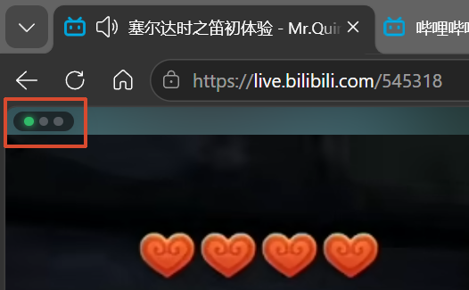
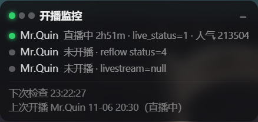
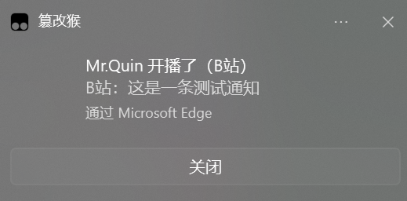
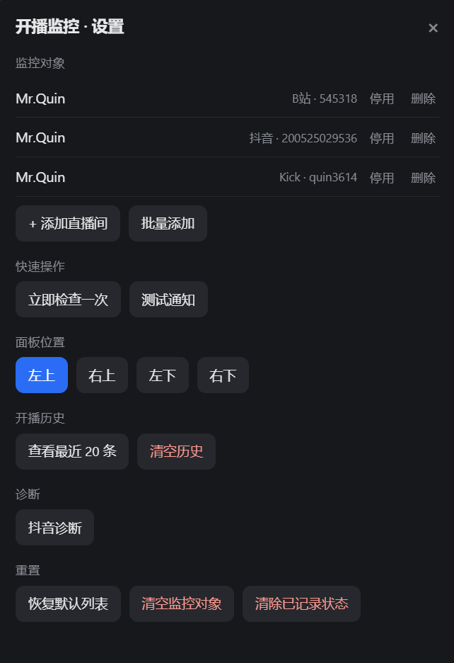
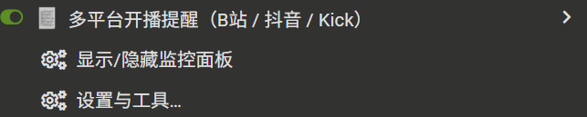

# 多平台开播提醒（B站 / 抖音 / Kick）

[](https://raw.githubusercontent.com/iiiMxy/live-alert/main/live-alert.user.js)
[](https://github.com/iiiMxy/live-alert/releases)
[](https://github.com/iiiMxy/live-alert/blob/main/LICENSE)


> 鉴于某摸鱼主播四处流窜，还存在偷偷开播不发消息——于是整了这么个小脚本

一个 Tampermonkey 用户脚本：监控你关注的直播间，**开播时弹出带封面和标题的系统通知**，并记录开播历史。想盯谁自己加——支持 B站 / 抖音 / Kick，粘贴直播间链接就能识别，不看了随时删。不用装 Python、不用跑后台服务、不用开机自启，打开一个直播间页面就够了

> **关于本项目**：需求和取舍由我提出，代码与文档在 DeepSeek Harness 协助下完成。我不是专业前端，欢迎提建议或 issue；简单问题我会尽量转成提示词让 AI 排查，复杂改动不保证及时响应——毕竟靠的是「大肥鱼之力」🐳

---

## 功能

- **开箱即用**：内置 Mr.Quin 的 B站 / 抖音 / Kick 三路直播间，装好就能监控
- **多平台**：B站、抖音、Kick
- **多直播间**：列表在设置面板里随时增删，支持粘贴整条链接自动识别平台
- **合并通知**：同一分钟里多个平台同时开播，合成一条通知，不轰炸
- **带封面和标题**：通知里直接显示直播间封面和当前直播标题
- **开播历史**：记录每场的开始/结束时间和时长，可在设置里查看
- **状态面板**：角落里一个可收起的小胶囊，三个点分别对应三个直播间
- **只在真正开播时提醒**：首次运行只建立基线，不会一装就弹；数据源异常时点变红，而不是误报

---

## 界面预览

### 折叠态：角落里的一条小胶囊

默认收成一个不到 60px 宽的胶囊，只留三个状态点，不挡视线。绿=在播，灰=未播，红=数据源异常。



### 展开态：一眼看清三路状态

点一下胶囊展开。每行是一个直播间：平台、在播/未播、已播时长、接口原始读数（人气、status 等）；底部是下次检查时间和最近一次开播记录。



### 开播提醒：Windows 右下角通知

带直播间封面和当前直播标题，点通知直接打开对应直播间。多平台同时开播会合并成一条，不会连着弹三次。



> 上图为「测试通知」的效果，真实开播时标题与正文会替换成实际的直播间信息。

### 设置面板：增删直播间都在这里

监控对象可逐条停用/删除，也可批量粘贴链接添加；面板位置四角可选；另有开播历史、抖音诊断与重置项。全部是页面内浮层，按 Esc 关闭。



### Tampermonkey 菜单只有两条

脚本入口刻意收得很短，功能都收进设置面板，不在扩展菜单里堆一长串。



---

## 安装

### 方式一：从链接安装（推荐）

1. 装好 [Tampermonkey](https://www.tampermonkey.net/)（Edge / Chrome / Firefox 均可）
2. 点这个链接安装 → **[安装 live-alert.user.js](https://raw.githubusercontent.com/iiiMxy/live-alert/main/live-alert.user.js)**
3. Tampermonkey 会弹出安装页，点「安装」

> **打不开 Raw 链接？**（国内网络常见）用镜像安装：
> **[cdn.jsdelivr.net 镜像](https://cdn.jsdelivr.net/gh/iiiMxy/live-alert@main/live-alert.user.js)**
>
> 两个链接装出来的脚本完全一样，区别只在于以后从哪个地址检查更新。想固定版本可以把 `@main` 换成 `@1.0.0`。

### 方式二：手动新建

1. 点 Tampermonkey 图标 → 「添加新脚本」
2. 清空编辑器，粘贴本仓库的 `live-alert.user.js`
3. `Ctrl + S` 保存

装好后**打开任意一个直播间页面**（比如 `https://live.bilibili.com/`），脚本才会开始工作。

---

## 首次使用

脚本**内置了 Mr.Quin 的三路直播间**（B站 `545318` / 抖音 `200525029536` / Kick `quin3614`）——这个工具本来就是为盯他写的。装好之后打开任意直播间页面，它就已经在监控了，不需要任何配置。

### 不关注他？两种做法

| 做法 | 操作 | 效果 |
|---|---|---|
| 逐条处理 | 设置 → 监控对象 → 「停用」或「删除」 | 停用只是不轮询，配置还在；删除则彻底移除 |
| 全部换掉 | 设置 → 重置 → **「清空监控对象」** | 清成空列表，之后自己添加 |

清空是可选项，不是必须的。以后想找回内置配置，点「恢复默认列表」即可。

### 添加自己的直播间

1. Tampermonkey 图标 → 「设置与工具…」
2. 「+ 添加直播间」：选平台，填房间号，或直接粘贴整条链接（平台会自动识别）
3. 或者「批量添加」：一行一个链接，一次全加进去

各平台要填的标识：

| 平台 | 填什么 | 例子 |
|---|---|---|
| B站 | 房间号 | `545318` |
| 抖音 | web_rid（直播间链接最后那串数字） | `200525029536` |
| Kick | 频道名 | `quin3614` |

---

## 设置面板

| 区块 | 作用 |
|---|---|
| 监控对象 | 增删直播间、临时停用（停用的不轮询、不提醒） |
| 快速操作 | 立即检查一次、发一条测试通知 |
| 面板位置 | 左上 / 右上 / 左下 / 右下，选完立即生效并记住 |
| 开播历史 | 查看最近 20 场、清空 |
| 诊断 | 抖音诊断（解析失败时输出可复制的排查信息） |
| 重置 | 恢复默认列表、清空监控对象、清除已记录状态 |

面板上的状态点：

- 🟢 直播中
- ⚪ 未开播
- 🔴 数据源异常（接口变了、被风控、网络不通）——**红色不会误报**，只是拿不到状态

---

## 重要限制（务必先读）

1. **必须有一个标签页常驻**
   脚本跑在网页里，关掉标签页就停止监控。建议把直播间页钉住（右键标签 → 固定）。

2. **Edge 的「睡眠标签页」会冻结它**
   后台待久了标签页会休眠，JS 全停，监控静默失效。
   `edge://settings/system` → 睡眠标签页 → 把对应站点加入「永不休眠」。

3. **后台标签页的定时器会被节流**
   隐藏超过 5 分钟后，定时器最多约 1 次/分钟。所以轮询间隔定在 60 秒，**提醒最多延迟 1 分钟**，这是浏览器行为，不是脚本能绕的。

4. **电脑关机 / 休眠 / 断网 = 不监控**
   这是本地脚本的物理上限。如果错过开播后果严重，建议叠加平台自家的手机推送做兜底。

5. **抖音走的是非公开接口**
   官方接口需要签名，脚本用的是 `reflow/info` 这个老接口，**随时可能失效**。失效时面板会变红，不会误报。B站和 Kick 不受影响。

6. **不做登录、不做自动签到、不做弹幕**
   脚本只读取开播状态，不代替你登录，也不发送任何内容。

---

## 隐私

- 不收集、不上报任何数据，没有统计埋点
- 只向三个平台的接口发起 GET 请求：`api.live.bilibili.com`、`live.douyin.com` / `webcast.amemv.com`、`kick.com`
- 配置、历史、缓存全部存在浏览器本地（Tampermonkey 的 GM 存储）
- 清浏览器数据会丢失历史和配置

---

## 常见问题

**装了没反应？**
先确认页面地址命中 `@match`（只对三个直播域名生效），再看右下角有没有面板；没有就是 Tampermonkey 没启用或脚本没保存。

**面板显示红色？**
点「设置与工具…」→「抖音诊断」把结果复制出来，通常是平台接口变了。

**开播了但没弹通知？**
检查 Windows 专注助手是否拦截、Edge 是否允许通知；可以先用「测试通知」验证链路。

**重复弹了？**
多个标签页同时开着时脚本会自行选一个作为主导，正常不会重复。若仍出现，开「清除已记录状态」重来一次。

---

## 开发

结构很简单，分四层：

```
配置区        CONFIG（间隔、位置、边距）
数据层        targets / state / history，全部走 GM 存储
探测层        probeBilibili / probeDouyin / probeKick，统一返回
              { online, title, cover, startedAt, detail }
界面层        HUD（常驻小胶囊）+ 设置浮层（增删与管理）
```

**加一个新平台**：写一个 `probeXxx(t)`，在 `PROBES` 里注册，`@connect` 加上域名，再在 `PLATFORMS` 和 `PLATFORM_LABEL` 里补一项，约 20 行。

---

## 许可

MIT，见 [LICENSE](LICENSE)。

## 免责

仅供个人学习与自用。脚本依赖各平台的非公开接口，不保证长期可用；请遵守所在平台的服务条款，不要用于高频抓取或商业用途。

内置的默认列表只是公开可访问的直播间地址，与主播本人无任何隶属关系；如相关方有异议，删除默认列表即可。
